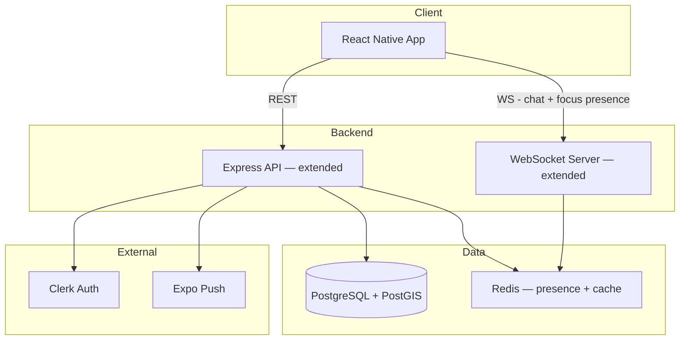
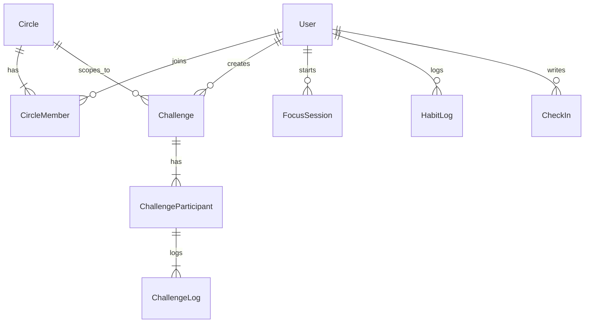

# Design: Disconnect Platform Expansion — Social Productivity Hub

| Field        | Value                                              |
|-------------|-----------------------------------------------------|
| Status      | Draft                                               |
| Created     | 2026-05-12                                          |
| Author      | Dylan                                               |
| Spec        | `docs/specs/rfc-disconnect-platform.md`             |
| Phase       | Design                                              |

## Overview

This design extends the Disconnect app (React Native + Node.js/Express + PostgreSQL/PostGIS) with 5 new concepts: **Circles**, **Challenges**, **Focus Sessions**, **Habit Tracking**, and **Daily Check-ins**. All build on the existing auth (Clerk), database, WebSocket, and push notification infrastructure.

The app navigation changes from 3 tabs to 4: **Events | Map | Hub | Profile**. The Hub tab is the home for all new features.

---

## Architecture

### System Context (Extended)



### New Entity Relationships



---

## Database Schema (New Tables)

### Migration: 009_create_circles.ts

```sql
CREATE TABLE circles (
    id UUID PRIMARY KEY DEFAULT uuid_generate_v4(),
    name VARCHAR(50) NOT NULL,
    creator_id UUID NOT NULL REFERENCES users(id),
    invite_code VARCHAR(8) UNIQUE NOT NULL,
    created_at TIMESTAMPTZ DEFAULT NOW()
);

CREATE TABLE circle_members (
    circle_id UUID NOT NULL REFERENCES circles(id) ON DELETE CASCADE,
    user_id UUID NOT NULL REFERENCES users(id),
    joined_at TIMESTAMPTZ DEFAULT NOW(),
    PRIMARY KEY (circle_id, user_id)
);

CREATE INDEX idx_circle_members_user ON circle_members(user_id);
```

### Migration: 010_create_challenges.ts

```sql
CREATE TABLE challenges (
    id UUID PRIMARY KEY DEFAULT uuid_generate_v4(),
    creator_id UUID NOT NULL REFERENCES users(id),
    circle_id UUID REFERENCES circles(id) ON DELETE SET NULL,  -- NULL = public
    title VARCHAR(100) NOT NULL,
    description VARCHAR(500),
    duration_days INT NOT NULL CHECK (duration_days IN (7, 14, 21, 30)),
    daily_requirement VARCHAR(200) NOT NULL,
    category VARCHAR(30) NOT NULL,  -- phone_free, walk, deep_work, digital_sunset, gratitude, custom
    research_note VARCHAR(300),  -- citation for the practice
    starts_at DATE NOT NULL,
    ends_at DATE NOT NULL,
    is_public BOOLEAN DEFAULT false,
    location GEOGRAPHY(POINT, 4326),  -- for public/city-scoped challenges
    created_at TIMESTAMPTZ DEFAULT NOW()
);

CREATE TABLE challenge_participants (
    challenge_id UUID NOT NULL REFERENCES challenges(id) ON DELETE CASCADE,
    user_id UUID NOT NULL REFERENCES users(id),
    joined_at TIMESTAMPTZ DEFAULT NOW(),
    completed BOOLEAN DEFAULT false,
    PRIMARY KEY (challenge_id, user_id)
);

CREATE TABLE challenge_logs (
    id UUID PRIMARY KEY DEFAULT uuid_generate_v4(),
    challenge_id UUID NOT NULL REFERENCES challenges(id) ON DELETE CASCADE,
    user_id UUID NOT NULL REFERENCES users(id),
    day_number INT NOT NULL,
    completed BOOLEAN NOT NULL DEFAULT true,
    photo_url TEXT,
    logged_at TIMESTAMPTZ DEFAULT NOW(),
    UNIQUE(challenge_id, user_id, day_number)
);

CREATE INDEX idx_challenges_public ON challenges(is_public, starts_at) WHERE is_public = true;
CREATE INDEX idx_challenges_circle ON challenges(circle_id);
CREATE INDEX idx_challenge_logs_lookup ON challenge_logs(challenge_id, user_id);
```

### Migration: 011_create_focus_sessions.ts

```sql
CREATE TABLE focus_sessions (
    id UUID PRIMARY KEY DEFAULT uuid_generate_v4(),
    user_id UUID NOT NULL REFERENCES users(id),
    intention VARCHAR(100),
    duration_minutes INT NOT NULL,
    started_at TIMESTAMPTZ NOT NULL DEFAULT NOW(),
    ended_at TIMESTAMPTZ,
    completed BOOLEAN DEFAULT false,
    circle_id UUID REFERENCES circles(id),  -- which circle to notify
    created_at TIMESTAMPTZ DEFAULT NOW()
);

CREATE INDEX idx_focus_sessions_user ON focus_sessions(user_id, started_at DESC);
CREATE INDEX idx_focus_sessions_active ON focus_sessions(ended_at) WHERE ended_at IS NULL;
```

### Migration: 012_create_habits.ts

```sql
CREATE TABLE user_habits (
    id UUID PRIMARY KEY DEFAULT uuid_generate_v4(),
    user_id UUID NOT NULL REFERENCES users(id),
    habit_id VARCHAR(30) NOT NULL,  -- from curated list, or 'custom'
    custom_name VARCHAR(50),  -- only for custom habits
    position INT NOT NULL DEFAULT 0,
    created_at TIMESTAMPTZ DEFAULT NOW(),
    UNIQUE(user_id, habit_id)
);

CREATE TABLE habit_logs (
    id UUID PRIMARY KEY DEFAULT uuid_generate_v4(),
    user_id UUID NOT NULL REFERENCES users(id),
    habit_id VARCHAR(30) NOT NULL,
    logged_date DATE NOT NULL DEFAULT CURRENT_DATE,
    logged_at TIMESTAMPTZ DEFAULT NOW(),
    UNIQUE(user_id, habit_id, logged_date)
);

CREATE INDEX idx_habit_logs_user_date ON habit_logs(user_id, logged_date DESC);
```

### Migration: 013_create_checkins.ts

```sql
CREATE TABLE check_ins (
    id UUID PRIMARY KEY DEFAULT uuid_generate_v4(),
    user_id UUID NOT NULL REFERENCES users(id),
    mood INT NOT NULL CHECK (mood BETWEEN 1 AND 5),
    good_thing_1 VARCHAR(100) NOT NULL,
    good_thing_2 VARCHAR(100) NOT NULL,
    good_thing_3 VARCHAR(100) NOT NULL,
    intention VARCHAR(50),
    check_in_date DATE NOT NULL DEFAULT CURRENT_DATE,
    created_at TIMESTAMPTZ DEFAULT NOW(),
    UNIQUE(user_id, check_in_date)
);

CREATE INDEX idx_checkins_user_date ON check_ins(user_id, check_in_date DESC);
```

### Migration: 014_create_reactions.ts

```sql
CREATE TABLE reactions (
    id UUID PRIMARY KEY DEFAULT uuid_generate_v4(),
    user_id UUID NOT NULL REFERENCES users(id),
    target_type VARCHAR(20) NOT NULL,  -- 'habit_log', 'check_in', 'challenge_log', 'focus_session'
    target_id UUID NOT NULL,
    emoji VARCHAR(4) NOT NULL DEFAULT '🔥',
    created_at TIMESTAMPTZ DEFAULT NOW(),
    UNIQUE(user_id, target_type, target_id)
);

CREATE INDEX idx_reactions_target ON reactions(target_type, target_id);
```

---

## API Endpoints (New)

### Circles

```
POST   /api/circles                 { name }                     → { circle, inviteCode }
GET    /api/circles                                              → { circles[] }
GET    /api/circles/:id                                          → { circle, members[] }
POST   /api/circles/:id/join       { inviteCode }               → { success }
DELETE /api/circles/:id/leave                                    → { success }
DELETE /api/circles/:id/members/:userId                          → { success } (creator only)
GET    /api/circles/:id/feed       ?since                       → { activity[] }
```

### Challenges

```
GET    /api/challenges              ?lat&lng&type=public|mine    → { challenges[] }
GET    /api/challenges/templates                                 → { templates[] }
POST   /api/challenges             { title, description, durationDays, dailyRequirement, category, circleId?, isPublic, location? } → { challenge }
GET    /api/challenges/:id                                       → { challenge, participants[], myProgress }
POST   /api/challenges/:id/join                                  → { success }
POST   /api/challenges/:id/log     { dayNumber, completed, photoUrl? } → { log }
GET    /api/challenges/:id/progress                              → { participantProgress[] }
```

### Focus Sessions

```
POST   /api/focus                  { durationMinutes, intention?, circleId? } → { session }
POST   /api/focus/:id/complete                                   → { session }
POST   /api/focus/:id/cancel                                     → { success }
GET    /api/focus/active           ?circleId                     → { activeSessions[] }
GET    /api/focus/history          ?limit                        → { sessions[] }
```

### Habits

```
GET    /api/habits                                               → { habits[], todayLogs[] }
POST   /api/habits                 { habitId, customName? }      → { habit }
DELETE /api/habits/:id                                           → { success }
POST   /api/habits/:habitId/log                                  → { log }
DELETE /api/habits/:habitId/log/:date                            → { success }
GET    /api/habits/streaks                                       → { streaks[] }
```

### Check-ins

```
POST   /api/checkins               { mood, goodThing1, goodThing2, goodThing3, intention? } → { checkIn }
GET    /api/checkins               ?limit                        → { checkIns[] }
GET    /api/checkins/today                                       → { checkIn | null }
```

### Reactions

```
POST   /api/reactions              { targetType, targetId, emoji } → { reaction }
DELETE /api/reactions/:id                                         → { success }
```

---

## File Structure (New Files)

### Server

```
server/src/
├── routes/
│   ├── circles.ts          # Circle CRUD + feed
│   ├── challenges.ts       # Challenge CRUD + logging
│   ├── focus.ts            # Focus session management
│   ├── habits.ts           # Habit setup + daily logging
│   ├── checkins.ts         # Daily check-in
│   └── reactions.ts        # Reactions (cross-feature)
├── models/
│   ├── circle.ts           # Circle queries
│   ├── challenge.ts        # Challenge queries
│   ├── focusSession.ts     # Focus session queries
│   ├── habit.ts            # Habit queries
│   ├── checkin.ts          # Check-in queries
│   └── reaction.ts         # Reaction queries
├── db/migrations/
│   ├── 009_create_circles.ts
│   ├── 010_create_challenges.ts
│   ├── 011_create_focus_sessions.ts
│   ├── 012_create_habits.ts
│   ├── 013_create_checkins.ts
│   └── 014_create_reactions.ts
├── ws/
│   └── focusPresence.ts    # WebSocket for live focus session presence
└── jobs/
    └── sendChallengeReminders.ts  # Daily challenge reminder cron
```

### App

```
app/src/
├── screens/
│   ├── hub/
│   │   ├── HubScreen.tsx           # Main hub overview (today's habits, active challenges, check-in prompt)
│   │   ├── CirclesScreen.tsx       # List of user's circles
│   │   ├── CircleDetailScreen.tsx  # Circle feed + members
│   │   ├── CreateCircleScreen.tsx  # Create new circle
│   │   ├── JoinCircleScreen.tsx    # Join via invite code
│   │   ├── ChallengesScreen.tsx    # Browse/join challenges
│   │   ├── ChallengeDetailScreen.tsx  # Challenge progress + daily log
│   │   ├── CreateChallengeScreen.tsx  # Create custom challenge
│   │   ├── FocusScreen.tsx         # Start/view focus session
│   │   ├── HabitsScreen.tsx        # Manage + log habits
│   │   └── CheckInScreen.tsx       # Daily check-in form
├── components/
│   ├── CircleFeedItem.tsx      # Activity item in circle feed
│   ├── ChallengeCard.tsx       # Challenge preview card
│   ├── HabitRow.tsx            # Single habit with tap-to-log
│   ├── FocusTimer.tsx          # Minimal timer display
│   ├── MoodSelector.tsx        # 1-5 emoji mood picker
│   └── ReactionButton.tsx      # Tap-to-react component
├── store/
│   ├── circleStore.ts
│   ├── challengeStore.ts
│   ├── focusStore.ts
│   ├── habitStore.ts
│   └── checkinStore.ts
├── hooks/
│   └── useFocusTimer.ts        # Client-side timer logic
└── constants/
    ├── habits.ts               # Curated habit list with research citations
    └── challengeTemplates.ts   # Pre-built challenge definitions
```

### Shared

```
shared/src/
├── types.ts           # Extended with Circle, Challenge, FocusSession, Habit, CheckIn types
├── habits.ts          # Curated habit definitions + research notes
└── challenges.ts      # Challenge template definitions
```

---

## Key Implementation Details

### Curated Habits (shared/src/habits.ts)

```typescript
export interface HabitDefinition {
  id: string;
  name: string;
  description: string;
  researchNote: string;
  citation: string;
  emoji: string;
  targetMinutes?: number;
}

export const CURATED_HABITS: readonly HabitDefinition[] = [
  {
    id: 'exercise',
    name: 'Exercise',
    description: '30+ minutes of physical activity',
    researchNote: 'Reduces depression with effect size d=0.68, comparable to antidepressants.',
    citation: 'Schuch et al. 2016',
    emoji: '🏃',
    targetMinutes: 30,
  },
  {
    id: 'nature',
    name: 'Nature Time',
    description: '20+ minutes outdoors',
    researchNote: 'Reduces cortisol by 21% per 30-minute session in natural settings.',
    citation: 'Hunter 2019',
    emoji: '🌿',
    targetMinutes: 20,
  },
  // ... (10 total)
] as const;
```

### Focus Session Presence (WebSocket)

```typescript
// Extends existing WebSocket setup at /ws/focus
// Client connects: ws://api/ws/focus?token=X&circleId=Y
// Server tracks active sessions per circle in Redis
// Broadcasts: { type: 'focus_update', activeSessions: [...] }
// Disconnection = session still running (timer is client-side)
// Completion is explicit: POST /api/focus/:id/complete
```

### Circle Feed Aggregation

```typescript
// GET /api/circles/:id/feed?since=ISO_DATE
// Aggregates from multiple sources (last 24h only):
// 1. habit_logs from circle members
// 2. check_ins from circle members
// 3. challenge_logs from circle members (in circle-scoped challenges)
// 4. focus_sessions from circle members
// Returns unified ActivityItem[] sorted by timestamp DESC, max 50
```

### Hub Screen Layout

The Hub is the daily "home" — it shows what matters RIGHT NOW:

```
┌─────────────────────────────┐
│  Today's Habits  [3/5 done] │  ← tap-to-log habit row
│  ○ Exercise  ● Nature  ○ ..│
├─────────────────────────────┤
│  Daily Check-in             │  ← if not done today
│  [How are you feeling?]     │
├─────────────────────────────┤
│  Active Challenge           │  ← current challenge progress
│  "30-Day Walk" — Day 12/30  │
│  [Log Today]                │
├─────────────────────────────┤
│  Focus                      │
│  [Start Session]  2 friends │  ← shows who's focusing now
│  focusing right now         │
├─────────────────────────────┤
│  My Circles                 │
│  [Circle 1]  [Circle 2]    │  ← tap to see feed
└─────────────────────────────┘
```

---

## Navigation (Updated)

```typescript
// 4-tab layout
<Tab.Navigator>
  <Tab.Screen name="EventsTab" />    // 📅 Events (existing)
  <Tab.Screen name="BeaconsTab" />   // 🗺 Map (existing)
  <Tab.Screen name="HubTab" />       // ⚡ Hub (NEW)
  <Tab.Screen name="ProfileTab" />   // 👤 Profile (existing)
</Tab.Navigator>

// Hub stack:
// HubScreen → CirclesScreen → CircleDetailScreen
//           → ChallengesScreen → ChallengeDetailScreen → CreateChallengeScreen
//           → FocusScreen
//           → HabitsScreen
//           → CheckInScreen
//           → JoinCircleScreen / CreateCircleScreen
```

---

## Challenge Templates (Pre-Built)

```typescript
export const CHALLENGE_TEMPLATES = [
  {
    id: 'phone_free_mornings',
    title: 'Phone-Free Mornings',
    description: 'No phone before 9am for 7 days.',
    durationDays: 7,
    dailyRequirement: 'Keep your phone untouched until 9:00 AM',
    category: 'phone_free',
    researchNote: 'Limiting phone use reduces anxiety and improves morning focus. (Hunt et al. 2018)',
  },
  {
    id: 'daily_walk_30',
    title: '30-Day Daily Walk',
    description: '30 minutes outdoors every day for 30 days.',
    durationDays: 30,
    dailyRequirement: 'Walk outside for at least 30 minutes',
    category: 'walk',
    researchNote: '30min in nature reduces cortisol by 21%. (Hunter 2019)',
  },
  {
    id: 'deep_work_week',
    title: 'Deep Work Week',
    description: '2+ hours of uninterrupted focus every day for 7 days.',
    durationDays: 7,
    dailyRequirement: 'Complete 2+ hours of focused, distraction-free work',
    category: 'deep_work',
    researchNote: 'Context switching costs 23 min per interruption. (Gloria Mark, UC Irvine)',
  },
  {
    id: 'digital_sunset',
    title: 'Digital Sunset',
    description: 'No screens after 9pm for 14 days.',
    durationDays: 14,
    dailyRequirement: 'Put all screens away by 9:00 PM',
    category: 'digital_sunset',
    researchNote: 'Evening screen reduction improves sleep onset by 20-30 min. (Chang et al. 2015)',
  },
  {
    id: 'gratitude_sprint',
    title: 'Gratitude Sprint',
    description: 'Log 3 good things every day for 7 days.',
    durationDays: 7,
    dailyRequirement: 'Write down 3 good things that happened today',
    category: 'gratitude',
    researchNote: 'Sustained happiness increase at 6-month follow-up, d=0.36. (Seligman 2005)',
  },
] as const;
```

---

## Testing Strategy

- **Unit tests**: Model queries (circle membership, challenge progress calculation, streak logic)
- **Integration tests**: API endpoints with test DB (create circle → join → post check-in → view feed)
- **Key edge cases**:
  - User in 3 circles posting a habit log → appears in all 3 feeds
  - Challenge participant misses a day → shown honestly in progress
  - Focus session WebSocket disconnect → session continues (timer is client-side)
  - User leaves a circle → their future activity stops appearing; past activity stays
  - Timezone handling: user in EST logs habit at 11:59pm → counts for today, not tomorrow

---

## Risks and Mitigations

| Risk | Likelihood | Impact | Mitigation |
|------|-----------|--------|------------|
| Feature bloat makes the app feel complex | Medium | High | Hub screen is dead simple — shows only TODAY's items. Detailed views are one tap deeper. |
| Circle feed becomes noisy with 8 active members | Medium | Medium | 24-hour window + max 50 items. Group reactions instead of individual notifications. |
| Focus timer accuracy on backgrounded app | High | Medium | Use Expo background fetch + local notifications for timer completion. Timer is cosmetic; server tracks start/end. |
| Challenge participation drops off after day 3 | High | Medium | Daily push reminder at user-chosen time. Circle visibility creates shame/motivation. |
| Users feel judged by Circle members | Low | High | No rankings, no "worst performer" signals. Missed days shown neutrally. Encouraging copy throughout. |

---

## Decisions Log

| Decision | Rationale | Alternatives Considered |
|----------|-----------|----------------------|
| Hub as 4th tab | Central daily dashboard reduces navigation friction | Drawer menu (hidden), sub-tabs within existing tabs (confusing) |
| WebSocket for focus presence | Reuses existing WS infrastructure, real-time updates | Polling every 30s (laggy), Firebase presence (new dependency) |
| Reactions as single tap (no text) | Prevents app from becoming a messaging platform | Comments (too engaging), no reactions (less motivating) |
| 24-hour feed window | Prevents infinite scrolling, keeps content fresh | 7-day window (too much), no feed (loses social visibility) |
| Curated habit list | Quality > quantity; research backing for each | Fully custom (no research grounding), 50+ options (decision paralysis) |
| Challenge logs are per-day (not per-attempt) | Simplicity; one entry per day drives consistency | Multiple entries per day (complex), honor system only (no logging) |

---

## References

- Specification: `docs/specs/rfc-disconnect-platform.md`
- Existing design: `docs/designs/design-disconnect-mvp.md`
- Existing WebSocket pattern: `server/src/ws/chatHandler.ts`
- Existing migrations: `server/src/db/migrations/`
- Existing Zustand store pattern: `app/src/store/eventStore.ts`
